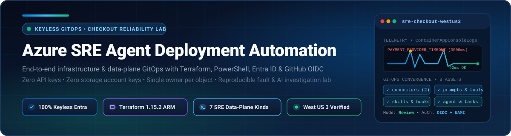
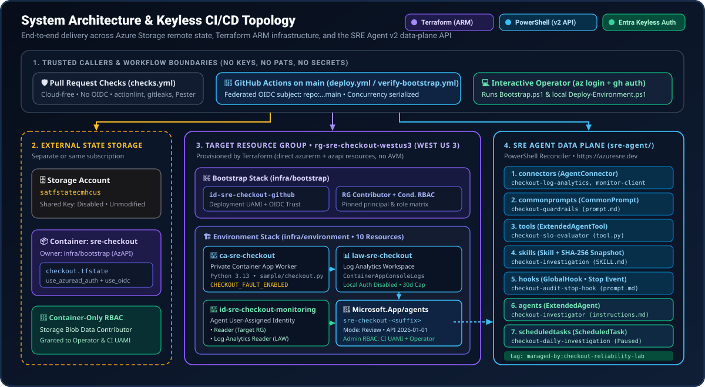
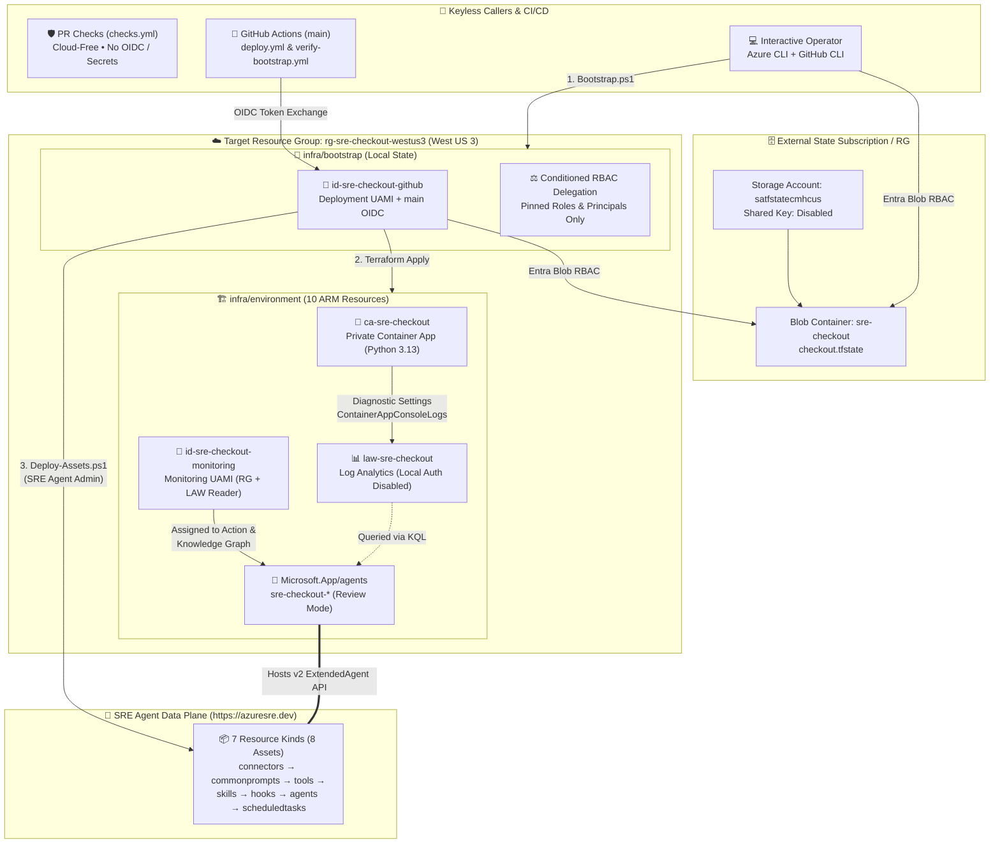
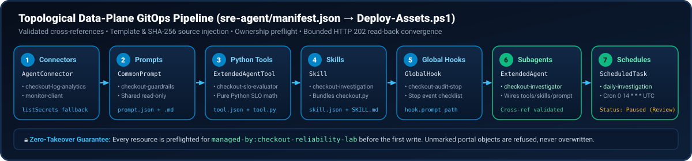
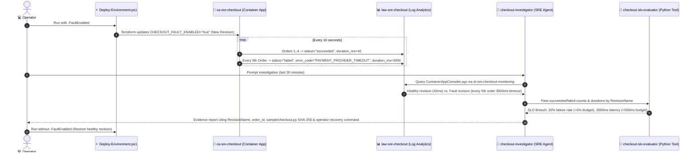
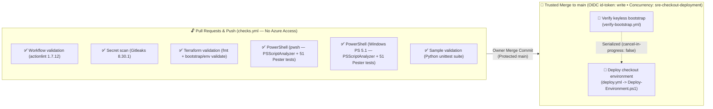

<div align="center">



<br />

[](https://github.com/christopherhouse/Azure-SRE-Agent-Deployment-Automation/actions/workflows/checks.yml)
[](https://github.com/christopherhouse/Azure-SRE-Agent-Deployment-Automation/actions/workflows/verify-bootstrap.yml)
[](https://github.com/christopherhouse/Azure-SRE-Agent-Deployment-Automation/actions/workflows/deploy.yml)


[](LICENSE)

**A 100% keyless, GitOps-driven Azure SRE Agent reference architecture built around the _Checkout Reliability Lab_: a deliberately faultable checkout workload, structured Log Analytics telemetry, and an automated 7-kind SRE Agent data-plane reconciliation pipeline.**

[🎯 Start Here](#-documentation-hub) • [⚡ How It Works (1-Pager)](docs/how-it-works.md) • [🏛️ Architecture](#️-architecture) • [🔄 GitOps Data Plane](#-sre-agent-data-plane-gitops-catalog) • [🚀 Quickstart](#-end-to-end-quickstart) • [🔬 Fault & Investigation Flow](#-checkout-reliability-lab-fault--investigation-flow) • [🛡️ CI/CD & Checks](#️-cicd-trust--validation-matrix)

</div>

This repository demonstrates end-to-end CI/CD for **Azure SRE Agent** using a two-stage automation pipeline (**[read the 1-page How It Works guide](docs/how-it-works.md)**): **Terraform** provisions the Azure infrastructure (`Microsoft.App/agents`, Log Analytics, managed identities, and a sample Container Apps checkout workload), while **PowerShell** packages and reconciles the agent's versioned data-plane catalog (connectors, shared prompts, custom Python tools, skills, hooks, subagents, and scheduled tasks) against the SRE Agent v2 API. Pull requests run cloud-free static validation and Pester tests, and merges to `main` authenticate via **GitHub OIDC** and **Entra ID**—with zero API keys, storage keys, or repository secrets—to converge both Azure resources and agent intelligence in a single workflow run.

---

## 🧭 Documentation Hub

| Phase / Guide | Focus Area | Key Artifacts & Evidence |
| :--- | :--- | :--- |
| ⚡ **[How It Works (1-Pager)](docs/how-it-works.md)** | Plain-English overview of the CI/CD pipeline, Terraform `Microsoft.App/agents` resource, and `sre-agent/` v2 data-plane API mapping | `deploy.yml`, `infra/environment/`, `sre-agent/` |
| 📜 **[Project Charter](docs/project-charter.md)** | Vision, boundaries, keyless constraints, and Checkout Reliability Lab goals | Scope decisions & success criteria |
| 🗺️ **[Implementation Plan](docs/implementation-plan.md)** | Ordered 6-phase delivery plan and completion gates | Phase 1–6 verification checklist |
| 🤝 **[Contributing Guide](CONTRIBUTING.md)** | Local toolchain setup, exact validation commands, PS 5.1 rules, and PR flow | `actionlint`, `gitleaks`, `Test-Repository.ps1` |
| 🥾 **[Phase 2: Identity & State Bootstrap](docs/bootstrap.md)** | Operator bootstrap, federated GitHub OIDC identity, container-scoped Blob RBAC | `infra/bootstrap/`, `scripts/Bootstrap.ps1` |
| 🏗️ **[Phase 3: Environment & Checkout Lab](docs/environment.md)** | West US 3 SRE Agent, Log Analytics, private Python worker, conditioned CI RBAC | `infra/environment/`, `sample/checkout.py` |
| 🧠 **[Phase 4: Data-Plane GitOps Assets](docs/data-plane.md)** | 7-kind v2 API reconciliation, ownership tags, SHA-256 source bundling, OAuth boundaries | `sre-agent/`, `scripts/DataPlane.ps1` |
| 🚀 **[Phase 5: GitHub Actions Delivery](docs/delivery.md)** | Unified orchestrator, deterministic asset packaging, serialized `main` OIDC CI/CD | `scripts/Deploy-Environment.ps1`, `deploy.yml` |
| 🔬 **[Phase 6: Live Demo & Handoff](docs/demonstration.md)** | Fault injection walkthrough, KQL queries, live agent transcript, cost & safe teardown | Thread `c63b8c97-fac0-42c9-958a-cdca00609ee5` |

---

## 🏛️ Architecture

<div align="center">
  
</div>

### 🔗 Plane & Identity Topology (Mermaid)



---

## 🔄 SRE Agent Data-Plane GitOps Catalog

<div align="center">
  
</div>

Definitions and companion files live under `sre-agent/`, driven by [`sre-agent/manifest.json`](sre-agent/manifest.json). `scripts/DataPlane.ps1` discovers every `<kind>/<name>/` directory, validates cross-references before any network call, injects runtime template tokens (`{{WorkspaceCustomerId}}`, `{{SubscriptionId}}`, `{{ResourceGroupName}}`, `{{MonitoringIdentityResourceId}}`, `{{SourceSnapshot}}`, `{{ContextHash}}`), and reconciles all **7 supported v2 resource kinds** in topological dependency order:

| # | Directory & API Kind | Envelope `type` | Deployed Resource(s) | Purpose in Checkout Reliability Lab |
| :-: | :--- | :--- | :--- | :--- |
| **1** | `sre-agent/connectors/`<br/>`connectors` | `AgentConnector` | • `checkout-log-analytics`<br/>• `monitor-client` | Binds `law-sre-checkout` using `id-sre-checkout-monitoring` and registers the built-in Azure Monitor MCP connector (with `/connectors/listSecrets` read-back verification). |
| **2** | `sre-agent/common-prompts/`<br/>`commonprompts` | `CommonPrompt` | • `checkout-guardrails` | Shared read-only investigation rules, bounded 30m KQL windowing, per-revision `order_id` scoping, and anti-hallucination guardrails (`prompt.md`). |
| **3** | `sre-agent/tools/`<br/>`tools` | `ExtendedAgentTool` | • `checkout-slo-evaluator` | Custom Python function tool (`tool.py`, `toolMode: Auto`) that computes checkout failure rate, latency delta, and breach status against a 5% / 500 ms SLO budget. |
| **4** | `sre-agent/skills/`<br/>`skills` | `Skill` | • `checkout-investigation` | Step-by-step KQL correlation workflow (`SKILL.md`) bundling the checked-out `sample/checkout.py` source snapshot and its SHA-256 hash. |
| **5** | `sre-agent/hooks/`<br/>`hooks` | `GlobalHook` | • `checkout-audit-stop-hook` | `Stop`-lifecycle prompt hook (`hook.prompt`) that verifies the final response cites `RevisionName`, `ContextHash`, missing-data windows, and operator-only recovery. |
| **6** | `sre-agent/agents/`<br/>`agents` | `ExtendedAgent` | • `checkout-investigator` | Specialized subagent (`instructions.md`) wiring `RunAzCliReadCommands`, `checkout-slo-evaluator`, `checkout-guardrails`, and `checkout-investigation`. |
| **7** | `sre-agent/scheduled-tasks/`<br/>`scheduledtasks` | `ScheduledTask` | • `checkout-daily-investigation` | Daily `0 14 * * *` UTC scheduled investigation routed to `checkout-investigator` in `Review` mode (`status: Paused` by default to prevent idle spend). |

---

## 🔬 Checkout Reliability Lab: Fault & Investigation Flow

The sample workload ([`sample/checkout.py`](sample/checkout.py)) runs inside a private Azure Container App (`ca-sre-checkout`) with no public ingress or external dependencies. Every 10 seconds it emits a structured JSON checkout event to `stdout`, which Azure Monitor routes into the resource-specific `ContainerAppConsoleLogs` table in `law-sre-checkout`.



---

## ⚡ End-to-End Quickstart

### 1️⃣ One-Time Operator Bootstrap

Sign in interactively to Azure CLI and GitHub CLI, select your target deployment subscription, and run `Bootstrap.ps1` with the full ARM resource ID of your external state storage account:

```powershell
az login
az account set --subscription <target-subscription-id>
gh auth login

$stateAccountId = '/subscriptions/<state-sub>/resourceGroups/<state-rg>/providers/Microsoft.Storage/storageAccounts/<account>'
.\scripts\Bootstrap.ps1 -StateStorageAccountId $stateAccountId -Apply -ConfigureGitHub
```

### 2️⃣ Deploy Infrastructure & All 7 Data-Plane Resource Kinds

Run the unified orchestrator locally (works identically in `pwsh` and Windows PowerShell 5.1):

```powershell
.\scripts\Deploy-Environment.ps1 `
    -StorageAccountName <account> `
    -ContainerName sre-checkout `
    -StateKey checkout.tfstate `
    -Authentication AzureCli
```

On the **first** operator deployment, grant the bootstrap stack's conditioned CI RBAC delegation so GitHub Actions on `main` can manage the environment's deterministic role assignments:

```powershell
$monitoringPrincipal = terraform -chdir=infra\environment output -raw monitoring_principal_id
.\scripts\Bootstrap.ps1 `
    -StateStorageAccountId $stateAccountId `
    -MonitoringPrincipalId $monitoringPrincipal `
    -Apply `
    -ConfigureGitHub
```

### 3️⃣ Inject the Controlled Fault & Recover

```powershell
# Inject deterministic PAYMENT_PROVIDER_TIMEOUT on every 5th order
.\scripts\Deploy-Environment.ps1 `
    -StorageAccountName <account> `
    -ContainerName sre-checkout `
    -StateKey checkout.tfstate `
    -Authentication AzureCli `
    -FaultEnabled

# Restore healthy checkout traffic (fault_enabled = false)
.\scripts\Deploy-Environment.ps1 `
    -StorageAccountName <account> `
    -ContainerName sre-checkout `
    -StateKey checkout.tfstate `
    -Authentication AzureCli
```

> 💡 **Walkthrough & KQL Queries:** Follow [docs/demonstration.md](docs/demonstration.md) for the exact Log Analytics verification script, SRE Agent investigation prompt, live thread evidence, and non-destructive teardown instructions.

---

## 🗂️ Repository Map

```text
Azure-SRE-Agent-Deployment-Automation/
├── .github/
│   ├── copilot-instructions.md               # Repository-wide Copilot guardrails
│   ├── skills/deployment-contract-review/    # Ownership & keyless boundary review skill
│   └── workflows/
│       ├── checks.yml                        # Cloud-free PR & main static validation (6 jobs)
│       ├── verify-bootstrap.yml              # Trusted main-only OIDC & Blob lease verification
│       └── deploy.yml                        # Trusted main-only Terraform + data-plane delivery
├── docs/
│   ├── assets/                               # Custom SVG architecture & pipeline diagrams
│   ├── how-it-works.md                       # 1-page plain-English overview of CI/CD, Terraform & Data-Plane API
│   ├── project-charter.md                    # Vision, scope, and keyless constraints
│   ├── implementation-plan.md                # 6-phase plan and completion criteria
│   ├── bootstrap.md                          # Phase 2 identity & remote-state bootstrap guide
│   ├── environment.md                        # Phase 3 Terraform infrastructure & workload guide
│   ├── data-plane.md                         # Phase 4 7-kind SRE Agent data-plane guide
│   ├── delivery.md                           # Phase 5 GitHub Actions OIDC delivery guide
│   └── demonstration.md                      # Phase 6 fault/investigation walkthrough & cleanup
├── infra/
│   ├── bootstrap/                            # Operator local-state Terraform (RG, CI UAMI, OIDC, container)
│   └── environment/                          # Entra Blob backend Terraform (SRE Agent, LAW, Container App, RBAC)
├── sample/
│   ├── checkout.py                           # Dependency-free synthetic checkout emitter (Python 3.13)
│   └── test_checkout.py                      # Standard-library unit tests for healthy & fault modes
├── sre-agent/
│   ├── manifest.json                         # Schema v1 topological kind registry & ownership marker
│   ├── connectors/                           # AgentConnector definitions (Log Analytics & Monitor MCP)
│   ├── common-prompts/                       # CommonPrompt shared guardrails (JSON + Markdown)
│   ├── tools/                                # ExtendedAgentTool custom Python SLO evaluator (JSON + .py)
│   ├── skills/                               # Skill definition & runbook bundling sample/checkout.py
│   ├── hooks/                                # GlobalHook Stop-event audit checklist (JSON + Markdown)
│   ├── agents/                               # ExtendedAgent subagent wiring tools, prompts & skills
│   └── scheduled-tasks/                      # ScheduledTask daily investigation definition (Paused)
├── scripts/
│   ├── Common.ps1                            # Keyless environment assertions & native command wrappers
│   ├── Bootstrap.ps1                         # Operator bootstrap & GitHub variable configuration
│   ├── Initialize-Backend.ps1                # Entra Blob backend initializer (AzureCli / GitHubOidc)
│   ├── Test-StateAccess.ps1                  # Non-state Blob write/lease/cleanup probe
│   ├── DataPlane.ps1                         # 7-kind discovery, cross-ref validation, packaging & v2 API client
│   ├── Deploy-Assets.ps1                     # Scoped ARM discovery & idempotent data-plane deployer
│   ├── Deploy-Environment.ps1                # Unified Terraform + packaged data-plane orchestrator
│   └── Test-Repository.ps1                   # PSScriptAnalyzer + Pester runner (pwsh & PS 5.1)
└── tests/                                    # 51 cloud-free mocked Pester tests across 4 test suites
```

---

## 🛡️ CI/CD Trust & Validation Matrix



- **Required Branch Protection Checks:** `Workflow validation` and `Secret scan` run on every PR and push without path filters.
- **Defense in Depth:** GitHub secret scanning and push protection are enabled alongside full-history Gitleaks checks, immutable SHA-pinned GitHub Actions, and `Assert-KeylessEnvironment` runtime variable guards.

---

## 📄 License

Released under the [MIT License](LICENSE).
