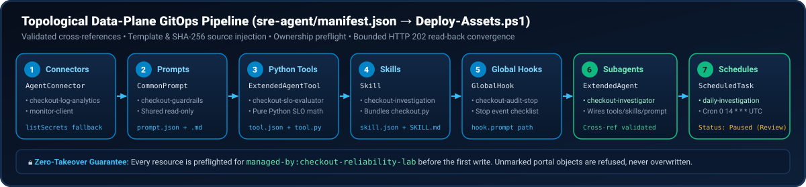
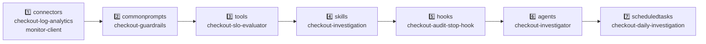

# 🧠 Phase 4: SRE Agent Data-Plane GitOps Catalog

> **Navigation:** [🏠 README](../README.md) • [📜 Charter](project-charter.md) • [🗺️ Plan](implementation-plan.md) • [🥾 Phase 2: Bootstrap](bootstrap.md) • [🏗️ Phase 3: Environment](environment.md) • **🧠 Phase 4: Data Plane** • [🚀 Phase 5: Delivery](delivery.md) • [🔬 Phase 6: Demo](demonstration.md)

<div align="center">
  
</div>

PowerShell owns the SRE Agent data-plane resource catalog under `sre-agent/`
(connectors, common prompts, custom Python tools, skills, global hooks,
subagents, and scheduled tasks). Terraform continues to own the agent,
identities, workspace, workload and RBAC. Do not add ARM sub-resources for
these data-plane objects to Terraform, even though ARM exposes some of the same
configuration. GitHub OAuth is an operator-owned connection, not part of either
reconciliation loop.



## Assets and ownership contract

| Object | Owner / plane | Identity and scope | Repeat-run behavior |
| --- | --- | --- | --- |
| `checkout-log-analytics` & `monitor-client` connectors | PowerShell / data plane | Selected CLI or CI OIDC identity; SRE Agent Administrator on this agent (`checkout-log-analytics` binds `id-sre-checkout-monitoring`) | Persisted `extendedProperties.description` ownership marker checked via `/connectors/listSecrets` when single-item GET masks properties; PUT only on change |
| `checkout-guardrails` common prompt | PowerShell / data plane | Same configuration identity | Owner tag checked, rendered Markdown compared, PUT only on change |
| `checkout-slo-evaluator` Python tool | PowerShell / data plane | Same configuration identity; pure Python SLO calculator (`toolMode: Auto`) | Owner tag checked, function code and parameters compared, PUT only on change |
| `checkout-investigation` skill | PowerShell / data plane | Same configuration identity; SRE Agent Administrator on this agent | Owner tag checked, intended properties compared, PUT only on change |
| `checkout-audit-stop-hook` global hook | PowerShell / data plane | Same configuration identity; `Stop` lifecycle verification hook | Owner tag checked, nested `hook.prompt` and properties compared, PUT only on change |
| `checkout-investigator` custom agent | PowerShell / data plane | Same configuration identity; attaches `RunAzCliReadCommands`, `checkout-slo-evaluator`, `checkout-guardrails`, and `checkout-investigation` | Same owner tag and property verification; prompt, tool, and skill dependencies deployed first |
| `checkout-daily-investigation` task | PowerShell / data plane | Same configuration identity; Review mode, status `Paused` | Persisted description ownership marker checked; status and routing verified |
| GitHub source connection | Operator / interactive OAuth | GitHub account authorized in Code access | Not overwritten or adopted by the deployment |
| HTTP webhook | Not deployed | No identity/exposure contract assumed | Not applicable |

Definitions and prompts live under `sre-agent/`, organized by SRE Agent
data-plane resource kind rather than by a single scenario folder:

| Kind directory | `/api/v2/extendedAgent/<kind>` | Envelope `type` | Resource manifest | Deployed examples |
| --- | --- | --- | --- | --- |
| `sre-agent/connectors/<name>/` | `connectors` | `AgentConnector` | `connector.json` | `checkout-log-analytics`, `monitor-client` |
| `sre-agent/common-prompts/<name>/` | `commonprompts` | `CommonPrompt` | `prompt.json` + `prompt.md` | `checkout-guardrails` |
| `sre-agent/tools/<name>/` | `tools` | `ExtendedAgentTool` | `tool.json` + `tool.py` | `checkout-slo-evaluator` |
| `sre-agent/skills/<name>/` | `skills` | `Skill` | `skill.json` + `SKILL.md` | `checkout-investigation` |
| `sre-agent/hooks/<name>/` | `hooks` | `GlobalHook` | `hook.json` + `prompt.md` | `checkout-audit-stop-hook` |
| `sre-agent/agents/<name>/` | `agents` | `ExtendedAgent` | `agent.json` + `instructions.md` | `checkout-investigator` |
| `sre-agent/scheduled-tasks/<name>/` | `scheduledtasks` | `ScheduledTask` | `task.json` + `prompt.md` | `checkout-daily-investigation` |

`sre-agent/manifest.json` declares `schemaVersion: 1`, the repository ownership
marker (`managed-by:checkout-reliability-lab`), the bundled `sourcePath`
(`sample/checkout.py`), and the topological kind registry (`connectors` ->
`commonprompts` -> `tools` -> `skills` -> `hooks` -> `agents` ->
`scheduledtasks`). Adding a new connector, common prompt, custom Python tool,
skill, hook, subagent, or scheduled task requires only adding a new `<name>/`
subdirectory under the corresponding kind folder—no changes to PowerShell
scripts or GitHub Actions workflows are needed.

During rendering, `Get-SreAgentAsset` (`scripts/DataPlane.ps1`) substitutes
workspace/subscription/RG/monitoring-UAMI context into JSON properties and
companion files referenced by `contentFiles` (supporting dotted property paths
such as `hook.prompt` and `.md`, `.txt`, `.json`, `.kql`, `.yaml`, `.yml`, and
`.py` extensions) and bundles the checked-out `sample/checkout.py` text plus
its SHA-256 into `{{SourceSnapshot}}` / `{{ContextHash}}`. This is a labeled
source snapshot, not evidence of live GitHub access or the running revision's
source. Prompts require telemetry/source correlation, bounded KQL queries,
revision-aware order IDs, explicit evidence gaps and operator-only recovery.

`scripts/Deploy-Assets.ps1` resolves the selected subscription and discovers
the agent endpoint from ARM using the environment's pinned `2026-01-01` API.
It resolves the workspace customer ID from the same RG using `2025-07-01`.
It does not read remote state, change subscriptions, assign roles or modify
the shared state account. `scripts/DataPlane.ps1` discovers the `sre-agent/`
resource tree in dependency order, validates directory-to-name matching and
cross-references (`allowedSkills` -> `skills/<name>`, `commonPrompts` ->
`commonprompts/<name>`, lowercase kebab-case `tools` -> `tools/<name>`, and
`scheduledtasks.agent` -> `agents/<name>`), and reconciles every discovered
resource.

The script obtains a short-lived Entra token for `https://azuresre.dev` from
the current Azure CLI session. Bearers stay in memory, are never passed in
native command arguments, and are cleared from local variables on exit.
Endpoint validation requires an HTTPS `*.azuresre.ai` root URL, default TLS
port, no user information/query/fragment, and no redirects. Do not enable
PowerShell tracing, HTTP debugging or Azure CLI debug output around deployment.

All names are preflighted before the first write. Common-prompt, custom-tool,
skill, global-hook, and custom-agent ownership uses the exact
`managed-by:checkout-reliability-lab` envelope tag. The current scheduled-task
and connector services drop envelope tags on read-back (and single-item
connector `GET` masks `dataSource` and `extendedProperties`), so
`Get-SreAgentAsset` appends ` [managed-by:checkout-reliability-lab]` to
`properties.description` on scheduled tasks and
`properties.extendedProperties.description` on connectors, and
`Get-AgentResource` queries `/api/v2/extendedAgent/connectors/listSecrets`
when single-item connector read-back masks `dataSource`. Removing a marker in
the portal causes the next deployment to refuse that object, not silently take
it over. Ownership markers are an operator convention, not a security boundary;
Azure RBAC controls access.

Existing unmarked or incompatible objects require explicit ownership review.
There is deliberately no force/adopt switch, automatic delete/recreate,
name-based takeover, pruning or local ownership ledger. If a marker was lost,
independently verify the object's provenance and exact configuration before
an operator restores it. Do not mark unrelated objects merely to pass checks.

## Deploy locally

Complete the [environment deployment](environment.md) first. Use the same
selected Azure CLI subscription and the operator's Entra identity. The
environment stack already grants the operator and deployment UAMI SRE Agent
Administrator at agent scope; no new roles are needed. The monitoring UAMI
keeps only its existing RG Reader and workspace Log Analytics Reader grants.

From the repository root, in Windows PowerShell 5.1 or hosted-compatible
`pwsh`:

```powershell
.\scripts\Deploy-Assets.ps1 -AgentName <environment-agent-name>
```

Use the non-secret `agent_id` environment Terraform output or the portal to
identify the name. The default RG is `rg-sre-checkout-westus3`. Successful
output is only `Configured kind/name` or `Unchanged kind/name`; prompts,
service response bodies, tokens and generated URLs are not printed.

Run the same command again. It must report all discovered assets unchanged. An
owned property change is reconciled with PUT and verified by GET; unrelated
service-generated properties are not considered drift. Array order, string
case and boolean types are checked. Do not edit the same objects concurrently;
the API contract used here does not provide conditional-write guarantees.
Phase 5 serializes trusted deployments and stages the versioned assets through
`New-SreAgentAssetPackage` before invoking `Deploy-Assets.ps1 -PackagePath`; see
[delivery.md](delivery.md).

The task is deliberately **Paused**, with a daily `0 14 * * *` UTC schedule.
To activate it, change `properties.status` to `Active` in the versioned task
definition, review and deploy. This incurs scheduled agent work. Return it to
`Paused` through Git when finished. Do not use the recipe's `isEnabled` field:
the tested preview silently ignores it. The custom-agent definition has no
`agentType`: the service also omits that recipe field. Review mode belongs
to the task; the custom agent has only the explicit read tool and skill.

In the agent portal, inspect the skill text, custom agent's tool/skill list,
and task's Paused status and response agent. A manual chat can invoke
`/agent checkout-investigator` and ask for the last 30 minutes of checkout
evidence. Actual investigation quality and an automatic execution remain
Phase 6 evidence, not something inferred from configuration read-back.

## Failure and retry semantics

HTTP calls have a 60-second timeout and at most four attempts for HTTP 408,
429, 500, 502, 503 and 504, sleeping 2, 4 and 8 seconds. Authentication,
authorization, invalid requests, unsupported endpoints/methods, redirects and
transport failures fail immediately. A GET 404 is considered absent only
during explicit existence/read-back checks; a PUT 404/405 still fails.
Fix permissions or an unsupported contract rather than supplying credentials
or changing API routes speculatively.

PUT HTTP 202 means accepted, not deployed. The caller verifies the exact
named resource, ownership and intended properties with at most four GET
checks (2, 4 and 8-second intervening delays). It fails if properties were
dropped or do not converge, even after a successful HTTP write. No operation
URL is followed or logged. A slow apply can finish after the bounded wait;
inspect the service and rerun rather than increasing retries indefinitely.

Native Azure CLI errors and terminating HTTP/read-back errors fail the run.
Failure stops downstream assets; completed earlier writes remain owned and
are reconciled on the next run. There is no transactional rollback or
success-shaped skip of unavailable APIs. Error messages include method,
status and attempt but omit response bodies that might echo sensitive content.

For a non-mutating deliberate failure, run deployment with a known nonexistent
agent name. ARM discovery must fail before token acquisition or asset writes.
Mocked tests additionally cover failed PUTs and verify dependent writes stop.
Do not deliberately corrupt the live checkout assets to test error reporting.

## GitHub OAuth and webhook limitations

Current Microsoft guidance supports **OAuth for github.com**. In the SRE Agent
portal, open **Build + setup > Context > Code access > GitHub > Add repository**,
enter this repository URL and choose OAuth. Complete interactive sign-in,
review the requested access and save the connection. Do not select PAT or
bring-your-own GitHub App: this repository forbids PATs and app private keys.
The deployment identity's Azure OIDC trust is not GitHub repository access.
No headless OAuth consent flow or export of the resulting token is implemented.

Validate the connection by asking the parent agent to read `sample/checkout.py`
from this repository, then inspect the repository tool card and cited ref.
Only that successful service-backed read is evidence of a working connection.
The bundled source snapshot is usable without OAuth but must be identified
as such. OAuth consent is an unavoidable operator step here and was not
completed during the recorded verification.

No HTTP trigger or GitHub webhook is created. The Learn API reference describes
the external trigger route as public/no-auth; the product documentation now
describes bearer authentication and `AgentThreadWrite`. This conflict is not
resolved by guessing, and a GitHub webhook does not gain an Entra bearer merely
because Actions can use OIDC. There is no verified end-to-end keyless GitHub
webhook contract in this implementation. The supported scheduled-task path
avoids exposing a trigger URL; it remains paused until deliberately activated.

## Evidence and remaining verification

Live configuration evidence recorded **November 16–17, 2026** using the existing
West US 3 agent and the selected local Azure CLI and hosted GitHub OIDC
identities:

- All seven v2 asset collections (`connectors`, `commonprompts`, `tools`,
  `skills`, `hooks`, `agents`, and `scheduledtasks`) returned HTTP 200 with the
  documented Entra audience. Writes and read-back verification succeeded across
  all eight deployed resources.
- Live responses exposed HTTP 202 acceptance and dropped recipe properties.
  The deployer failed rather than hiding these mismatches. Task `isEnabled`
  was ignored and initially yielded Active; the newly created task was paused
  using Microsoft's runtime pause API after resolving its runtime ID.
  The runtime operation dropped task tags too. The exact newly created task
  was explicitly migrated to the persisted description marker; no unmanaged
  object was adopted. The final version uses verified `status: Paused` PUTs.
- Single-item `GET /api/v2/extendedAgent/connectors/<name>` responses mask
  `dataSource` and `extendedProperties`; `Get-AgentResource` falls back to
  `POST /api/v2/extendedAgent/connectors/listSecrets` so connector type,
  managed-identity binding, and description ownership markers are verified on
  every run.
- Both `pwsh` and Windows PowerShell 5.1 subsequently reported all eight
  deployed assets across all seven kinds unchanged. Read-back confirmed the
  intended properties, owner markers, Review mode and Paused task. No Terraform
  resource, monitoring permission or shared state-account setting changed.
- A deliberate nonexistent-agent deployment in a separate Windows PowerShell
  process failed ARM discovery and exited 1. No token acquisition or asset
  writes followed that failure.

Cloud-free Pester tests (`51/51` passing in both `pwsh` and Windows PowerShell
5.1) separately cover rendering, recursive JSON token expansion, dotted
`contentFiles` paths (`hook.prompt`), `.py` companion file loading, cross-reference
validation, `/connectors/listSecrets` fallback, scoped ARM discovery, audience
and UTF-8 request construction, endpoint rejection, ownership collisions, task
tag loss, retries, failed PUTs, missing read-back properties, asynchronous
acceptance and repeated convergence. These mocks are not proof of live scheduled
execution, GitHub access or investigation accuracy.

Hosted OIDC data-plane deployment is verified in Phase 5 (`deploy.yml`, runs
`43942955764` and `44111399839`; see [delivery.md](delivery.md)), and live
fault/recovery investigation and scheduled-task status reconciliation are
verified in Phase 6 (thread `c63b8c97-fac0-42c9-958a-cdca00609ee5`; see
[demonstration.md](demonstration.md)). Interactive GitHub OAuth consent remains
an explicit operator step; no webhook delivery is claimed.

For retirement, delete only these specifically owned assets after verifying
their markers and pausing the task. This phase adds no bulk deletion script.
Infrastructure retirement remains the separate reviewed Terraform procedure;
preserve the external state account, container and state history.

## Primary contracts checked

- [Microsoft Learn API reference](https://learn.microsoft.com/en-us/azure/sre-agent/api-reference):
  Entra audience, agent-scoped configuration RBAC and v2 routes.
- [Official deployment request envelopes](https://github.com/microsoft/sre-agent/blob/main/sreagent-templates/bicep/apply-extras.sh):
  `Skill`, `ExtendedAgent`, `ScheduledTask` and their property mappings.
  Live read-back is essential: not every recipe property is retained.
- [Scheduled tasks](https://learn.microsoft.com/en-us/azure/sre-agent/scheduled-tasks)
  and [custom agents](https://learn.microsoft.com/en-us/azure/sre-agent/sub-agents):
  task modes and scheduling; custom-agent mode is not set in its definition.
- [Official task model and runtime service](https://github.com/microsoft/mcp/tree/main/tools/Azure.Mcp.Tools.SreAgent/src):
  task status and runtime-ID-based pause behavior.
- [Source code connections](https://learn.microsoft.com/en-us/azure/sre-agent/connect-code-service):
  github.com OAuth and validation.
- [Product API reference](https://sre.azure.com/docs/reference/api-reference):
  conflicting external-trigger authentication description, not used here.
