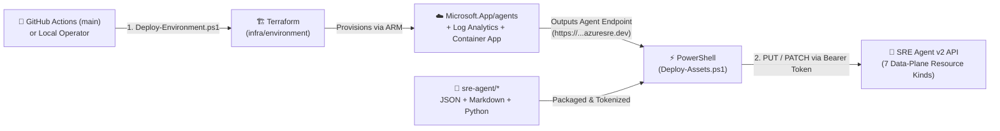

# ⚡ How It Works: 1-Page Guide

> **Navigation:** [🏠 README](../README.md) • **⚡ How It Works** • [📜 Charter](project-charter.md) • [🗺️ Plan](implementation-plan.md) • [🥾 Phase 2: Bootstrap](bootstrap.md) • [🏗️ Phase 3: Environment](environment.md) • [🧠 Phase 4: Data Plane](data-plane.md) • [🚀 Phase 5: Delivery](delivery.md) • [🔬 Phase 6: Demo](demonstration.md)

At a high level, deploying an **Azure SRE Agent** has two halves:
1. **The Azure Resource (Control Plane):** Creating the SRE Agent in Azure alongside its Log Analytics workspace, managed identities, RBAC roles, and the sample checkout app. **Terraform** handles this.
2. **The Agent's Brain (Data Plane):** Configuring what the agent knows and can do—its connectors, prompts, Python tools, skills, hooks, subagents, and schedules. **PowerShell + the SRE Agent v2 API** handles this from source files in `sre-agent/`.

---

## 1️⃣ The CI/CD Piece (`checks.yml` & `deploy.yml`)

Everything is automated through GitHub Actions with **zero stored secrets or API keys**:

* **On Pull Requests (`.github/workflows/checks.yml`):**
  Runs completely offline with no Azure access. It lints the workflows (`actionlint`), scans for secrets (`gitleaks`), validates the Terraform syntax, runs 51 mocked Pester tests against the PowerShell scripts (in both `pwsh` and Windows PowerShell 5.1), and unit-tests the Python sample app.
* **On Merge to `main` (`.github/workflows/deploy.yml`):**
  1. **Keyless Login:** GitHub Actions exchanges an OIDC token with Microsoft Entra ID to sign in as a User-Assigned Managed Identity (`id-sre-checkout-github`) created during one-time bootstrap.
  2. **Single Entrypoint:** The workflow runs [`scripts/Deploy-Environment.ps1`](../scripts/Deploy-Environment.ps1), which runs `terraform apply` first and then immediately calls `Deploy-Assets.ps1` to sync the agent's data-plane configuration.

---

## 2️⃣ Terraform for the Azure Resource (`infra/environment/`)

 Azure SRE Agent is an Azure Resource Manager (ARM) resource of type `Microsoft.App/agents`. Because it is currently in preview (`2025-05-01-preview`), we deploy it in [`infra/environment/main.tf`](../infra/environment/main.tf) using the Terraform `azapi_resource` provider alongside standard `azurerm` resources:

* **`azapi_resource.sre_agent` (`Microsoft.App/agents@2025-05-01-preview`):** Creates the SRE Agent in `westus3` in `Review` mode, attaches our monitoring User-Assigned Managed Identity (`id-sre-checkout-monitoring`), and links the Log Analytics workspace for knowledge graph and incident telemetry.
* **Supporting Infrastructure:** Terraform also provisions the Log Analytics workspace (`law-sre-checkout`), the private Container App running the faultable checkout simulator (`ca-sre-checkout`), and the RBAC role assignments:
  * Gives the **Monitoring Identity** `Reader` + `Log Analytics Reader` so the agent can query logs.
  * Gives the **Deployment Identity** `SRE Agent Administrator` so the next step in the pipeline is allowed to call the agent's data-plane API.

Once `terraform apply` finishes, Azure returns the agent's unique data-plane URL (`properties.agentEndpoint`, e.g., `https://<agent>.westus3.azuresre.dev`).

---

## 3️⃣ Data-Plane API & Source Files (`sre-agent/` + `scripts/DataPlane.ps1`)

While ARM creates the empty agent resource, the agent's actual capabilities live inside its **data-plane API** (`https://<agent>.westus3.azuresre.dev/api/...`).

Instead of clicking around in the portal, we store every data-plane object as code under [`sre-agent/`](../sre-agent/) and list their deployment order in [`sre-agent/manifest.json`](../sre-agent/manifest.json). Each object lives in its own folder with a small JSON envelope plus a readable companion file (Markdown or Python):

| Order | Source Folder & Files | What Gets Packaged | v2 Data-Plane API Endpoint | What It Does |
| :-: | :--- | :--- | :--- | :--- |
| **1** | `sre-agent/connectors/*/` `connector.json` | JSON payload with runtime Workspace ID & Managed Identity ID injected | `PUT /api/v2/extendedAgent/connectors/{name}` | Connects the agent to Log Analytics and the built-in Azure Monitor MCP server. |
| **2** | `sre-agent/common-prompts/checkout-guardrails/` `common-prompt.json` + `prompt.md` | `prompt.md` is embedded into `content` | `PUT /api/v2/extendedAgent/commonprompts/{name}` | Shared rules (read-only safety, 30-minute KQL windowing) reusable across subagents. |
| **3** | `sre-agent/tools/checkout-slo-evaluator/` `tool.json` + `tool.py` | `tool.py` is embedded into `properties.script` | `PUT /api/v2/extendedAgent/tools/{name}` | Custom Python function tool the agent calls to calculate checkout failure rate & SLO breaches. |
| **4** | `sre-agent/skills/checkout-investigation/` `skill.json` + `SKILL.md` | `SKILL.md` + live `sample/checkout.py` code & SHA-256 hash embedded into `skillContent` | `PUT /api/v2/extendedAgent/skills/{name}` | Step-by-step KQL investigation runbook with the exact application source code baked in. |
| **5** | `sre-agent/hooks/checkout-audit-stop-hook/` `hook.json` + `hook.prompt` | `hook.prompt` is embedded into `configuration.prompt` | `PUT /api/v2/extendedAgent/hooks/{name}` | Runs on the `Stop` lifecycle event to verify the agent cited the revision name and hash before finishing. |
| **6** | `sre-agent/agents/checkout-investigator/` `agent.json` + `instructions.md` | `instructions.md` embedded + references to the tool, prompt, and skill above | `PUT /api/v2/extendedAgent/agents/{name}` | Creates the specialized subagent that ties the prompt, Python tool, and investigation skill together. |
| **7** | `sre-agent/scheduled-tasks/checkout-daily-investigation/` `scheduled-task.json` + `prompt.md` | `prompt.md` embedded; matched by `name` (UUID-keyed) | `POST` or `PATCH /api/v2/scheduledtasks/{id}` | Schedules a daily cron run (`Paused` by default) targeting the `checkout-investigator` subagent. |

### How Reconciliation Works (`scripts/DataPlane.ps1` & `scripts/Deploy-Assets.ps1`)
1. **Validate & Bundle Offline:** `DataPlane.ps1` reads `sre-agent/manifest.json`, checks that every tool/skill/prompt referenced by a subagent or task actually exists in the repo, injects companion `.md`/`.py` files into the JSON envelopes, and replaces placeholders like `{{WorkspaceCustomerId}}` and `{{SourceSnapshot}}`.
2. **Acquire Entra Token:** `Deploy-Assets.ps1` requests a keyless Entra ID bearer token for `https://azuresre.dev` (`az account get-access-token --resource https://azuresre.dev`).
3. **Idempotent Upsert in Dependency Order:** Walking from step 1 (`connectors`) to step 7 (`scheduledtasks`), the script `GET`s the existing object on the agent, checks its ownership marker (`managedBy: Azure-SRE-Agent-Deployment-Automation`), and issues a `PUT` (or `POST`/`PATCH` for UUID-keyed scheduled tasks) to converge the live agent with Git, then reads every asset back to verify it landed cleanly.
